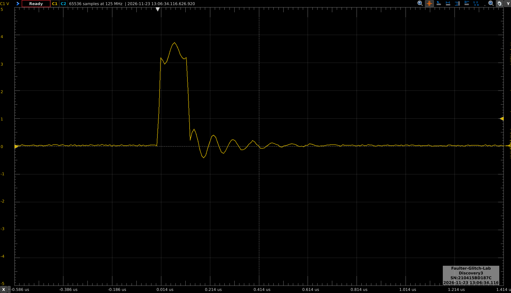

<p align="center">
  
</p>

<h1 align="center">Faulter</h1>

<p align="center">
  <strong>Nanosecond-Precision Hardware Fault-Injection Suite for Raspberry Pi Pico (RP2040)</strong>
</p>

<p align="center">
  
  
  
  
  
</p>

---

## What is Faulter?

**Faulter** is an open-source, professional-grade hardware fault injection (FI) instrumentation tool designed for hardware security researchers, reverse engineers, and embedded firmware developers. 

It enables precision **Voltage Glitching** (power crowbar attacks) using a standard, low-cost **Raspberry Pi Pico (RP2040)** paired with an external glitch MOSFET and a modern, high-speed desktop control GUI.

### How Voltage Glitching Works

During normal operation, a microchip (MCU, SoC, secure element) processes instructions sequentially, fetching opcodes, checking cryptographic signatures, and enforcing access controls. By momentarily shorting the target processor's power rail (VCC) to Ground (GND) for tens to hundreds of nanoseconds at an exact clock cycle:

1. Internal transistor logic levels drop below threshold.
2. The target CPU's program counter, registers, or comparator state corrupt.
3. Security verification routines (e.g. `if (password_ok)` or cryptographic signature checks) skip branch instructions or misread values.
4. Protected bootloaders can drop to shell, dump firmware keys, or bypass hardware root-of-trust authentication.

### Why RP2040 & PIO?

Traditional microcontroller fault injection tools rely on software `NOP` loops or CPU timers that suffer from interrupt latency, flash caching stalls, and clock jitter. Faulter offloads all countdown delays and pulse firing directly to the RP2040's hardware **Programmable I/O (PIO)** state machines:

- **8 Nanosecond Resolution**: Every instruction cycle runs deterministically at 125 MHz (1 cycle = 8 ns).
- **0 ns Jitter**: PIO operates completely independent of the CPU cores and is 100% immune to OS, interrupt, or USB bus timing variations.
- **Micro-Precision Countdown**: Post-trigger delays and pulse widths can be configured from **8 ns to over 4.29 seconds** with cycle-exact accuracy.

---

## What Faulter Does: Hardware Oscilloscope Capture

Below is a real-time digital oscilloscope trace of a calibrated Faulter glitch pulse captured on a **Digilent Discovery 3** at a 125 MHz sampling rate:

<p align="center">
  
</p>

### Trace Analysis:

- **Active Pulse Window**: The yellow trace ($\text{CH1}$) monitors the glitch MOSFET gate drive line (GPIO 19). Upon trigger, the PIO state machine drives the line HIGH for a calibrated **100 ns pulse width**, switching on the low-$R_{DS(on)}$ MOSFET to pull the target power rail to GND.
- **Sub-Microsecond Recovery**: Notice the clean rise time (~14 ns) and transient damping ringing settling back to steady-state GND in under $0.5\,\mu\text{s}$.
- **Synchronous Scope Monitor Output**: Faulter asserts a dedicated Scope Monitor pin (GPIO 9) synchronously during the glitch window, allowing oscilloscopes and logic analyzers to trigger reliably on every fault event.

---

## Key Features

- **Automated 2D Parameter Sweep (Brute-Force Search)**:
  - Systematically tests combinations of **Pulse Width Range** ($W_{start} \dots W_{end}, \Delta W$) and **Post-Trigger Delay Range** ($D_{start} \dots D_{end}, \Delta D$).
  - Supports configurable pause intervals in **µs, ms, or seconds** (with floating-point precision down to 0.01 ms).
- **Continuous Burst Execution**:
  - Continuous repeat loop firing pulses indefinitely until halted by the user via the `STOP BURST` or `STOP / ABORT` buttons.
- **Target Power Cycling Control**:
  - Drives an external relay or power MOSFET (GPIO 10) to cut and restore target power with configurable millisecond power-off durations before glitching.
- **Dynamic GPIO Mapping**:
  - Reconfigure glitch output, power cycle, and oscilloscope monitor pins on the fly without recompiling firmware.
- **Virtual Pico Simulator**:
  - Built-in hardware simulation engine allows testing all UI functions, sweeps, and telemetry logging without needing a physical Pico attached.
- **Reliable Binary Protocol**:
  - Request/response architecture using **COBS (Consistent Overhead Byte Stuffing)** packet framing and **CRC-16/CCITT** error detection running over USB CDC at 921,600 baud.

---

## Default Hardware Pinout

| Signal | RP2040 GPIO | Default Role | Description |
|---|---|---|---|
| **Glitch Output** | **GPIO 19** | Output (Active-HIGH) | Connects to N-channel MOSFET gate (e.g. IRLML2502) shorting target VCC to GND |
| **Power Cycle** | **GPIO 10** | Output (Active-LOW) | Connects to P-channel MOSFET or relay driving target power supply |
| **Scope Monitor** | **GPIO 9** | Output (Active-HIGH) | Connects to Oscilloscope Ch 1 or External Trigger for pulse capture |
| **USB CDC** | **USB Type-B / Micro** | Serial Comms | 921,600 baud binary telemetry and control link |

> *Note: Pin mappings can be customized in the UI configuration panel at runtime.*

---

## Installation & Building

### Prerequisites

- **Host Application**:
  - Modern C++ compiler supporting C++17 (`gcc` >= 9, `clang` >= 10, MSVC 2019+)
  - CMake >= 3.16
  - Qt6 or Qt5 development packages (`Widgets`, `Core`, `Gui`)
- **Firmware Compilation**:
  - ARM GCC toolchain (`arm-none-eabi-gcc` and `arm-none-eabi-newlib`)
  - CMake >= 3.13

---

### Step 1: Clone the Repository

Clone the repository and initialize only the required dependencies:

```bash
git clone https://github.com/Vorfed/Faulter.git
cd Faulter
./setup.sh
```

*(Or manually without the script: `git submodule update --init firmware/lib/pico-sdk && git -C firmware/lib/pico-sdk submodule update --init lib/tinyusb`)*

> [!TIP]
> **Why `./setup.sh`?**  
> Standard `git clone --recurse-submodules` downloads over **430 MB** of data because the upstream Raspberry Pi Pico SDK bundles huge wireless/Bluetooth libraries (`mbedtls`, `btstack`, `lwip`, `cyw43-driver`) intended only for the wireless Pico W.  
> Faulter runs on standard wired RP2040 and only needs **TinyUSB**. Running `./setup.sh` skips all unnecessary wireless stacks, reducing the download size to **~70 MB** and finishing in under 20 seconds.

---

### Step 2: Build the Desktop Host Application

From the root of the project:

```bash
# Configure and build both the GUI and unit tests
cmake -B build -S . -DBUILD_HOST=ON -DBUILD_TESTS=ON
cmake --build build -j$(nproc)

# Launch Faulter
./build/host-app/faulter
```

Or build the host application directly:
```bash
cd host-app
cmake -B build -S .
cmake --build build -j$(nproc)
./build/faulter
```

---

### Step 3: Build the RP2040 Firmware

Faulter automatically detects and links against the bundled Pico SDK located in `firmware/lib/pico-sdk`:

```bash
cd firmware
cmake -B build -S .
cmake --build build -j$(nproc)
```

The build generates:
- `faulter_fw.uf2` — Ready to flash onto your Pico.
- `faulter_fw.elf` / `faulter_fw.bin` / `faulter_fw.hex`

#### Flashing the Firmware:
1. Hold the **BOOTSEL** button on your Raspberry Pi Pico and plug it into your computer via USB.
2. The Pico will mount as a mass-storage drive named `RPI-RP2`.
3. Drag and drop `faulter_fw.uf2` onto the `RPI-RP2` volume.
4. The Pico will automatically reboot and enumerate as a USB CDC Serial device.

---

### Step 4: Run the Test Suite

Faulter includes full protocol verification tests (CRC-16 math, COBS encode/decode roundtrips, packet serialization) and headless Qt GUI component tests:

```bash
ctest --test-dir build --output-on-failure
```

---

## Operational Workflow

```
   ┌─────────────┐       ┌───────────────┐       ┌─────────────┐       ┌─────────────┐
   │ 1. CONNECT  │ ───►  │ 2. CONFIGURE  │ ───►  │   3. ARM    │ ───►  │   4. FIRE   │
   │ USB or Sim  │       │ Width & Delay │       │ Locks State │       │ PIO Trigger │
   └─────────────┘       └───────────────┘       └─────────────┘       └─────────────┘
                                                        ▲                     │
                                                        └───── [STOP/ABORT] ──┘
```

1. **Connect**: Select your Pico's serial port (e.g. `/dev/ttyACM0` on Linux or `COM3` on Windows) and click **Connect**, or select **Virtual Pico (Hardware Simulation)** for offline testing.
2. **Configure**: Set target pulse width, post-trigger delay, parameter sweep coordinates, or enable infinite burst execution.
3. **Arm**: Click **ARM GLITCH**. The parameters are validated and locked in hardware. The amber safety banner illuminates.
4. **Fire**: Click **FIRE BURST** (or **START BRUTE SWEEP** in 2D mode). The hardware fires with nanosecond precision. Pulse counts and live telemetry stream to the dashboard.
5. **Halt / Abort**: Click **STOP BURST** / **STOP SWEEP** or the emergency **STOP / ABORT** button at any time to immediately disarm the hardware.

---

## ⚠️ Important Safety & Hardware Brick Warning

> [!CAUTION]
> **HIGH RISK OF PERMANENT HARDWARE DAMAGE (BRICKING)**
>
> **Voltage fault injection involves deliberately shorting electrical power rails to ground.**
> - Fault injection can cause severe electrical stress, latch-up, overcurrent heating, and electromigration in the target silicon.
> - Improper pulse widths, inadequate decoupling, or excessive voltage levels **can permanently destroy (brick) your target microcontroller, SoC, or flash memory**.
> - **Always use a current-limited lab power supply** with fast overcurrent protection (OCP).
> - **Never experiment on valuable, primary, or production hardware.** Always conduct testing on sacrificial or expendable target boards.
> - The authors and contributors of Faulter accept **no liability or responsibility** for damaged hardware, lost data, or destroyed chips resulting from the use or misuse of this software.

---

## 🚧 Project Status: Active Development

Faulter is currently under **active, continuous development**.

- **Current Engineering Focus**: The project's immediate development cycle is actively focused on **fine-tuning exact nanosecond timing calibration and hardening the hardware trigger subsystem** (sub-microsecond edge alignment, trigger jitter minimization, and multi-channel synchronization).
- Features, GUI instrumentation layouts, and wire protocol packet definitions may undergo rapid iteration and breaking updates as physical test benches evolve.
- Future enhancements include dedicated external edge trigger qualification, clock glitching support, and automated trace capture integration.
- Contributions, issue reports, hardware test vectors, and pull requests are warmly encouraged!

---

<p align="center">
  <strong>Faulter Official Repository:</strong> <a href="https://github.com/Vorfed/Faulter">https://github.com/Vorfed/Faulter</a>
</p>
