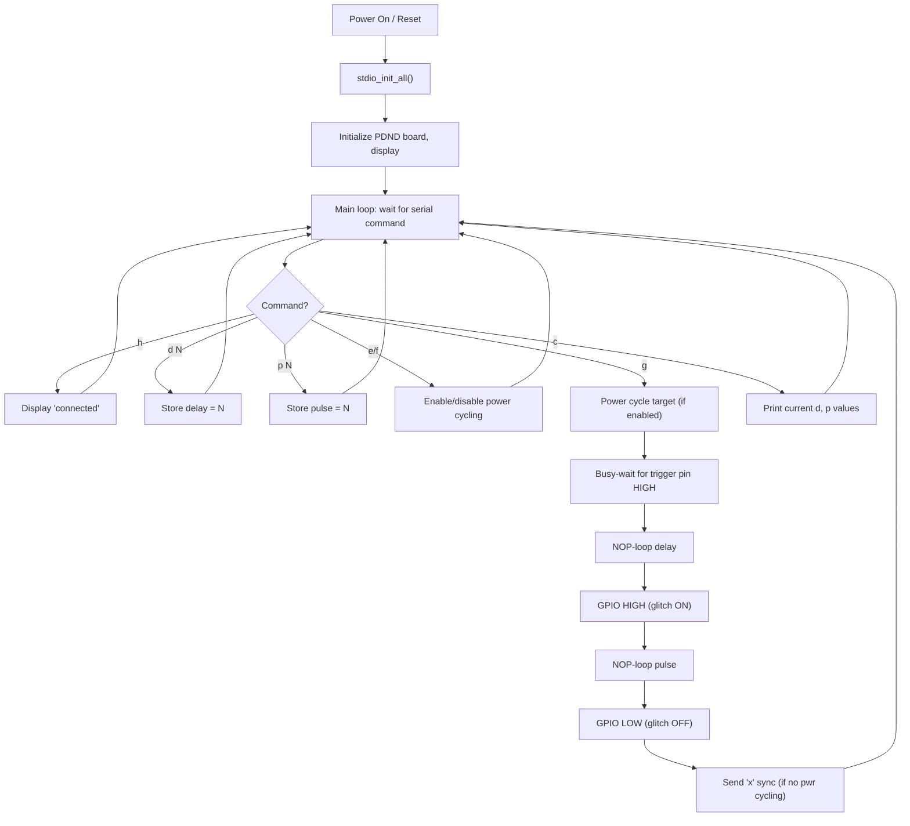

# Phase 0 — PicoGlitcher Reference Analysis

> **Project:** Faulter — PicoGlitcher Control Suite  
> **Date:** 2026-11-14  
> **Status:** CONFIRMED — decisions locked in, proceeding to implementation

---

## 1. Fault/Glitch Types Supported

The reference PicoGlitcher supports **one** fault type:

### 1.1 Voltage Glitching (Crowbar / Power Glitch)

**Mechanism:** The Pico drives a GPIO pin (pin 19, `PDND_GLITCH`) HIGH for a
controlled duration, which switches on an external MOSFET that momentarily
shorts (crowbars) the target's power rail to GND. This creates a brief voltage
dip on the target's VCC, potentially causing the target CPU to skip
instructions, corrupt reads, or fault security checks.

From `glitcher.cpp` lines 22–33:

```
Glitch: will pull the line to GND after an initial "delay" with a duration of "pulse"
GlitchEn: will be enabled if Glitch is pulled to GND.
```

**No other fault types are present** — there is no clock glitching, no EMFI
(electromagnetic fault injection), and no configurable glitch voltage level.
The glitch is a binary on/off crowbar pulse (full GND short).

### 1.2 Fault Types NOT Present (but mentioned in the prompt as possibilities)

| Type | Status | Notes |
|------|--------|-------|
| Clock glitching | **Not implemented** | No clock output manipulation code exists |
| EMFI | **Not implemented** | No electromagnetic pulse driver code |
| Configurable glitch voltage | **Not implemented** | The glitch is a hard GND pull via MOSFET; no DAC/PWM voltage control |
| Multi-stage / sequenced glitches | **Not implemented** | Single pulse only |

---

## 2. Complete Tunable Parameter List

### 2.1 Parameters Exposed via Serial Protocol

| Parameter | Command | Type | Units | Description |
|-----------|---------|------|-------|-------------|
| **Delay** | `d <value>` (ASCII `0x64`) | `uint32_t` | NOP loop iterations (~8 ns each at 125 MHz) | Number of NOP cycles between trigger event and the start of the glitch pulse |
| **Pulse Width** | `p <value>` (ASCII `0x70`) | `uint32_t` | NOP loop iterations (~8 ns each at 125 MHz) | Duration of the glitch pulse (how long MOSFET stays on) |
| **Power Cycling Enable** | `e` (ASCII `0x65`) | boolean | — | Enables automatic power-cycling of the target before each glitch |
| **Power Cycling Disable** | `f` (ASCII `0x66`) | boolean | — | Disables power-cycling |

### 2.2 Controller-Side Parameters (set in host Python script, not sent to firmware)

| Parameter | CLI Flag | Type | Description |
|-----------|----------|------|-------------|
| **Delay range** | `-d start stop step` | 3× int | Sweep range for delay (start, end, step) |
| **Pulse range** | `-p start stop step` | 3× int | Sweep range for pulse width (start, end, step) |
| **Baud rate** | `--baudrate` | int | Serial baud rate (default: 115200) |
| **Timeout** | `--timeout` | float | Serial read timeout in seconds (default: 0.1) |
| **Power cycling** | `--pwr-cycling` | string | `"enabled"` or `"disabled"` |

### 2.3 Trigger Source

The reference supports **one trigger source**: an **external GPIO edge** on
pin 18 (`PDND_TRIG`).

From `glitcher.cpp` line 160:
```c
// wait for external event, monitoring "Trig" pin
while(!gpio_get(PDND_TRIG));
glitch(delay, pulse);
```

The pin is configured as input with internal pull-up. The firmware busy-waits
until the pin reads HIGH (target is powered / trigger signal arrives), then
fires the glitch. If the pin is left unconnected, the pull-up keeps it HIGH
and the glitch fires immediately after the delay — effectively acting as
"immediate / no external trigger" mode.

**Trigger sources NOT present but candidates for our new design:**

| Trigger Type | Status in Reference |
|-------------|-------------------|
| External GPIO rising edge | ✅ Implemented (busy-wait poll) |
| External GPIO falling edge | ❌ Not implemented |
| UART pattern match | ❌ Not implemented (UART PIO programs exist in the codebase but are unused by the glitcher) |
| Power-on detect | ✅ Partially — the trigger pin is intended to detect target power-up |
| Timer / software trigger | ❌ Not implemented |
| SPI pattern match | ❌ Not implemented (SPI PIO programs exist but are unused by glitcher) |

### 2.4 Repeat / Burst Count

**Not implemented in firmware.** The firmware executes a single glitch per
`CMD_GLITCH` command. Repeat/sweep behavior is implemented entirely in the
host controller script via nested loops:

```python
for d in range(args.delay[0], args.delay[1] + 1, args.delay[2]):
    for p in range(args.pulse[0], args.pulse[1] + 1, args.pulse[2]):
        # send d, p, then glitch command
```

This means every iteration requires a full serial round-trip, adding
significant latency to parameter sweeps.

---

## 3. Host ↔ Firmware Communication Protocol

### 3.1 Physical Layer

| Property | Value |
|----------|-------|
| Interface | USB CDC (TinyUSB `stdio_usb`) + hardware UART (`stdio_uart`) |
| Baud rate | 115200 (set by host, firmware uses `stdio_init_all()` defaults) |
| Encoding | ASCII text |
| Line terminator | `\n` (newline) |
| Flow control | None |

### 3.2 Command Format

Commands are **single ASCII character** opcodes, optionally followed by a
space and a decimal integer argument, terminated by newline:

```
<cmd_char>[<space><decimal_integer>]\n
```

### 3.3 Complete Command Table

| Command | Char | Hex | Argument | Firmware Action |
|---------|------|-----|----------|-----------------|
| **Hello** | `h` | `0x68` | None | Displays "Client connected." on OLED. Handshake/init. |
| **Set Delay** | `d` | `0x64` | `uint32_t` (decimal) | Stores delay value, updates display |
| **Set Pulse** | `p` | `0x70` | `uint32_t` (decimal) | Stores pulse width value, updates display |
| **Enable Power Cycling** | `e` | `0x65` | None | Sets `pwr_cycl_en = true` |
| **Disable Power Cycling** | `f` | `0x66` | None | Sets `pwr_cycl_en = false` |
| **Glitch (Execute)** | `g` | `0x67` | None | If power cycling enabled: power-cycles target (50 ms OFF). Then waits for trigger pin HIGH. Then executes the glitch. If power cycling disabled: sends `x` back when done. |
| **Check** | `c` | `0x63` | None | Prints current delay and pulse values to serial (debug) |

### 3.4 Response / Telemetry

The firmware has **minimal feedback**:

- After a glitch with power cycling disabled, the firmware sends `"x"` to
  signal completion (used for synchronization).
- The `Check` command (`c`) prints: `"pio -> d: <delay>, p: <pulse>\n"`
- No timing telemetry (actual pulse measurements) is reported.
- No status/state machine information (armed, firing, idle) is reported.
- No error codes or error reporting.

### 3.5 Typical Command Sequence

```
Host → Pico:  h\n              (hello / handshake)
Host → Pico:  e\n              (enable power cycling)
Host → Pico:  d 25\n           (set delay = 25)
Host → Pico:  p 12\n           (set pulse = 12)
Host → Pico:  g\n              (execute glitch)
  [firmware power-cycles target, waits for trigger, fires glitch]
  [if pwr cycling disabled: Pico → Host: x]
Host → Pico:  d 26\n           (next delay value)
Host → Pico:  p 12\n           (same pulse)
Host → Pico:  g\n              (execute again)
  ...repeat for sweep...
```

### 3.6 Protocol Weaknesses (to fix in our design)

1. **No framing** — raw ASCII with no packet boundaries, checksums, or escape sequences. Susceptible to desynchronization if bytes are dropped.
2. **No acknowledgment** — commands are fire-and-forget (except the `x` sync for non-power-cycling mode). Host cannot confirm a parameter was accepted.
3. **No versioning** — no way to query firmware version or capabilities.
4. **No error reporting** — invalid commands are silently ignored (`default: break`).
5. **No status/state machine** — host cannot query whether firmware is armed, idle, or mid-glitch.
6. **No measured timing telemetry** — host has no way to know the actual pulse timing achieved.
7. **No arm/disarm/abort** — once `g` is sent, there's no way to cancel a pending glitch (e.g., if stuck waiting for trigger).

---

## 4. Timing Precision

### 4.1 Current Implementation: CPU NOP Loops (NOT PIO)

Despite the presence of PIO programs in the codebase (for SPI, I2C, UART),
**the actual glitch timing does NOT use PIO**. The glitch is generated with
bare CPU NOP busy-wait loops:

From `glitcher.cpp` lines 99–113:
```c
void glitch(uint32_t delay, uint32_t pulse) {
    // monitor pin ON
    for (uint32_t i = 0; i < delay; ++i) {
        __asm__("NOP");
    }
    gpio_put(PDND_GLITCH, 1);   // glitch ON
    for (uint32_t i = 0; i < pulse; ++i) {
        __asm__("NOP");
    }
    gpio_put(PDND_GLITCH, 0);   // glitch OFF
    // monitor pin OFF
}
```

### 4.2 Timing Resolution Analysis

The RP2040 runs at **125 MHz** by default (8 ns per cycle).

The NOP loop compiles (with optimization) to approximately:
```asm
loop:
    nop             ; 1 cycle
    sub r0, r0, #1  ; 1 cycle  (decrement counter)
    bne loop        ; 1 cycle  (branch)
```

This gives roughly **3 cycles per loop iteration = ~24 ns per unit** of
delay/pulse, plus loop overhead (comparison, branch setup).

| Metric | Value |
|--------|-------|
| **Minimum achievable resolution** | ~24 ns per NOP-loop step (at 125 MHz) |
| **Jitter** | Variable — CPU interrupts, USB polling, and stdio operations can preempt the NOP loop, causing timing jitter of potentially **microseconds** |
| **Trigger-to-glitch latency** | Variable — the busy-wait `while(!gpio_get(PDND_TRIG))` loop also has per-iteration overhead |

### 4.3 What Our Design Should Achieve (Improvements)

Using PIO state machines for the actual glitch generation would provide:

| Improvement | Benefit |
|-------------|---------|
| **PIO-based delay + pulse** | Deterministic 8 ns resolution (1 cycle at 125 MHz), zero jitter from CPU interrupts |
| **PIO-based trigger detection** | Deterministic trigger-to-action latency (no CPU polling jitter) |
| **Hardware timer for longer delays** | Microsecond-resolution delays without tying up a PIO SM |
| **DMA for burst/repeat patterns** | Zero CPU involvement during multi-pulse sequences |

### 4.4 Reference Timing Example

From the comments in `glitcher.cpp`:
```
./controller.py /dev/tty.usbmodem... --timeout 0.01 -p 10 15 1 -d 20 30 1
Generates a glitch after ~1us, with a length of ~0.5us.
```

This implies:
- delay=20 → ~1 µs → ~50 ns per unit (including loop overhead)
- pulse=10 → ~0.5 µs → ~50 ns per unit

This is consistent with a ~6-cycle loop body (NOP + loop counter + branch +
gpio overhead amortized), which at 125 MHz = 48 ns.

---

## 5. GPIO Pin Assignments

### 5.1 Glitcher-Specific Pins

| Pin (Pico) | Name | Direction | Function |
|-----------|------|-----------|----------|
| **GPIO 18** | `PDND_TRIG` | Input (pull-up) | External trigger input — monitors when target is "ready" (powered) |
| **GPIO 19** | `PDND_GLITCH` | Output (init LOW) | Glitch output — drives external MOSFET to crowbar target VCC to GND |
| **GPIO 9** | `PDND_GLITCH_MONITOR` | Output (optional) | Monitor output — HIGH during entire glitch window (delay + pulse). For oscilloscope monitoring. Disabled by default (`#ifdef ENABLE_MONITOR_PIN`). |
| **GPIO 10** | `PDND_POWER_CYCLE` | Output | Power cycle control — pulls LOW for 50 ms to power-cycle target via external switching hardware |

### 5.2 PDND Board General-Purpose I/O

| Pin (Pico) | Name | Direction | Function |
|-----------|------|-----------|----------|
| **GPIO 0** | `PDND_OE` | Output | Buffer output-enable (active LOW) — controls tri-state buffers |
| **GPIO 1–8** | `PDND_IN_BASE` | Input | 8-bit general-purpose input bus |
| **GPIO 9–16** | `PDND_OUT_BASE` | Output | 8-bit general-purpose output bus |

### 5.3 Display Pins

| Pin (Pico) | Name | Direction | Function |
|-----------|------|-----------|----------|
| **GPIO 20** | `PDND_DISP_SDA` / `PIN_SDA` | I/O (I2C via PIO0) | SSD1306 OLED display I2C data |
| **GPIO 21** | `PDND_DISP_SCL` / `PIN_SCL` | Output (I2C via PIO0) | SSD1306 OLED display I2C clock |

### 5.4 SPI Pins (via PIO1, used for pdnd_spi module)

| Pin (Pico) | Name | Function |
|-----------|------|----------|
| Mapped via `pdnd_out_pin(0)` | SPI CS | Chip select |
| Mapped via `pdnd_in_pin(0)` | SPI MISO | Data in |
| Mapped via `pdnd_out_pin(1)` | SPI WP | Write protect |
| Mapped via `pdnd_out_pin(2)` | SPI HOLD | Hold |
| Mapped via `pdnd_out_pin(3)` | SPI CLK | Clock |
| Mapped via `pdnd_out_pin(4)` | SPI MOSI | Data out |

---

## 6. Architecture Notes

### 6.1 Firmware Structure

The reference firmware is a **single-file monolith** (`glitcher.cpp`):

```
glitcher.cpp          — Main loop, command parser, glitch function (179 lines)
pdnd/pdnd.c/h         — Board abstraction (GPIO init, buffer control, pin mapping)
pdnd/pdnd_spi.c/h     — SPI via PIO (not used by glitcher)
pdnd/pdnd_display.c/h — OLED display driver (SSD1306 via I2C over PIO)
pdnd/pio/*.pio        — PIO programs (SPI, I2C, UART — only I2C used for display)
pdnd/display/*        — Font rendering, SSD1306 driver
```

### 6.2 Execution Flow



### 6.3 Build System

- **CMake** with Pico SDK integration (`pico_sdk_import.cmake`)
- Links: `pico_stdlib`, `pico_multicore`, `hardware_gpio`, `hardware_i2c`,
  `hardware_adc`, `hardware_pio`
- USB CDC stdio enabled (`pico_enable_stdio_usb`)
- Hardware UART stdio also enabled (`pico_enable_stdio_uart`)

### 6.4 Third-Party / External Dependencies

- **Raspberry Pi Pico SDK** (via git submodule)
- **TinyUSB** (bundled with Pico SDK, used for USB CDC serial)
- **SSD1306 OLED driver** (custom, in `pdnd/display/`)
- **OpenOCD** (used by the host controller script to verify glitch success via JTAG/SWD)

### 6.5 Use Case Context

The `testnrf.cfg` OpenOCD config reveals the target device: **Nordic nRF52**
(ARM Cortex-M4 @ 64 MHz). The attack scenario:
1. Power-cycle the nRF52 target
2. Wait for it to boot (trigger pin goes HIGH)
3. Fire a voltage glitch at a precise moment during boot
4. Use OpenOCD/JTAG to check if the glitch bypassed access protection (APPROTECT)
5. If successful, dump firmware via JTAG

---

## 7. Summary: Parameter Set for Our New Design

Based on this analysis, here is the **proposed parameter set** for the new
Faulter system. Items marked ★ are extensions beyond the reference:

### Core Parameters (from reference)

| Parameter | Type | Range | Resolution | Notes |
|-----------|------|-------|------------|-------|
| **Delay** (post-trigger) | `uint32_t` | 0 – 2³² | ~8 ns (PIO) ★ | Time between trigger event and glitch start |
| **Pulse Width** | `uint32_t` | 1 – 2³² | ~8 ns (PIO) ★ | Duration of the glitch pulse |
| **Power Cycling** | `bool` | on/off | — | Auto power-cycle target before each glitch |

### Trigger Configuration (extending reference)

| Parameter | Type | Options | Notes |
|-----------|------|---------|-------|
| **Trigger Source** | enum | `GPIO_RISING`, `GPIO_FALLING` ★, `UART_PATTERN` ★, `IMMEDIATE` ★ | Reference only supports GPIO rising edge |
| **Trigger GPIO Pin** | `uint8_t` | Configurable ★ | Reference hardcodes pin 18 |
| **Trigger UART Pattern** ★ | `uint8_t[]` | Up to N bytes | For UART pattern match trigger |

### Burst/Sweep Parameters (extending reference) ★

| Parameter | Type | Range | Notes |
|-----------|------|-------|-------|
| **Repeat Count** ★ | `uint16_t` | 1–65535 | Execute N glitches per command (firmware-side) |
| **Inter-Repeat Spacing** ★ | `uint32_t` | 0 – 2³² | Delay between consecutive pulses in a burst |

### Safety / State Machine ★

| Feature | Description |
|---------|-------------|
| **Arm / Disarm** ★ | Two-step activation: arm sets up, separate fire command triggers |
| **Abort** ★ | Cancel a pending/active glitch at any time |
| **State Reporting** ★ | Firmware reports: `IDLE`, `ARMED`, `WAITING_TRIGGER`, `FIRING`, `DONE`, `ERROR` |
| **Timing Telemetry** ★ | Report actual measured delay and pulse duration after each glitch |

---

## 8. Confirmed Design Decisions

| # | Question | Decision |
|---|----------|----------|
| 1 | **Glitch types** | Both voltage and clock glitching. V1 focuses on voltage glitching; architecture supports clock glitching as a future module. |
| 2 | **Trigger sources** | No triggers for V1. Immediate execution on FIRE command only. Trigger architecture reserved for future. |
| 3 | **Timing engine** | PIO-based high-performance GPIO on RP2040. Deterministic 8 ns resolution. |
| 4 | **PDND board I/O** | Stripped. Our tool is a standalone glitcher with essential pins only (glitch, power cycle, monitor). Desktop GUI replaces OLED. |
| 5 | **Target MCU** | RP2040. |
| 6 | **Power-cycle timing** | Fully configurable (off-duration in ms, sent as a parameter). |
